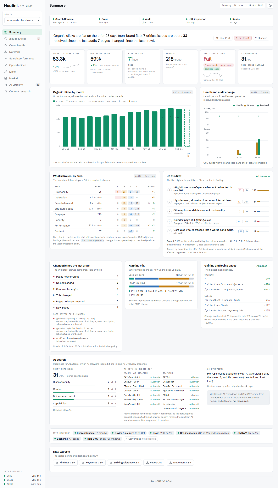
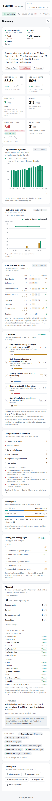
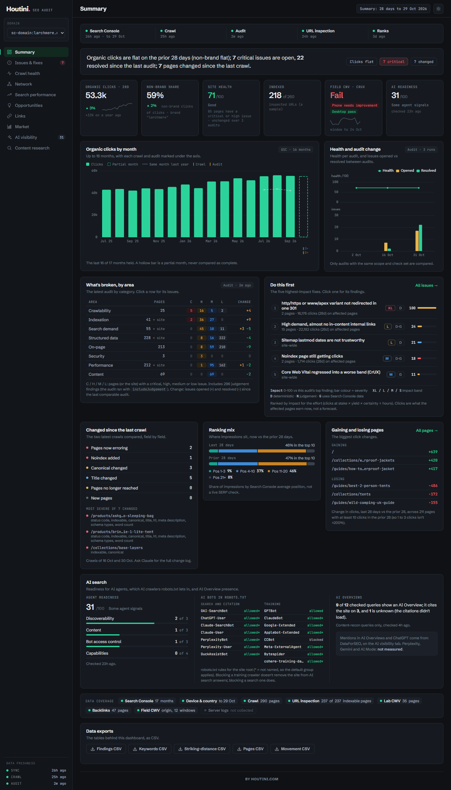
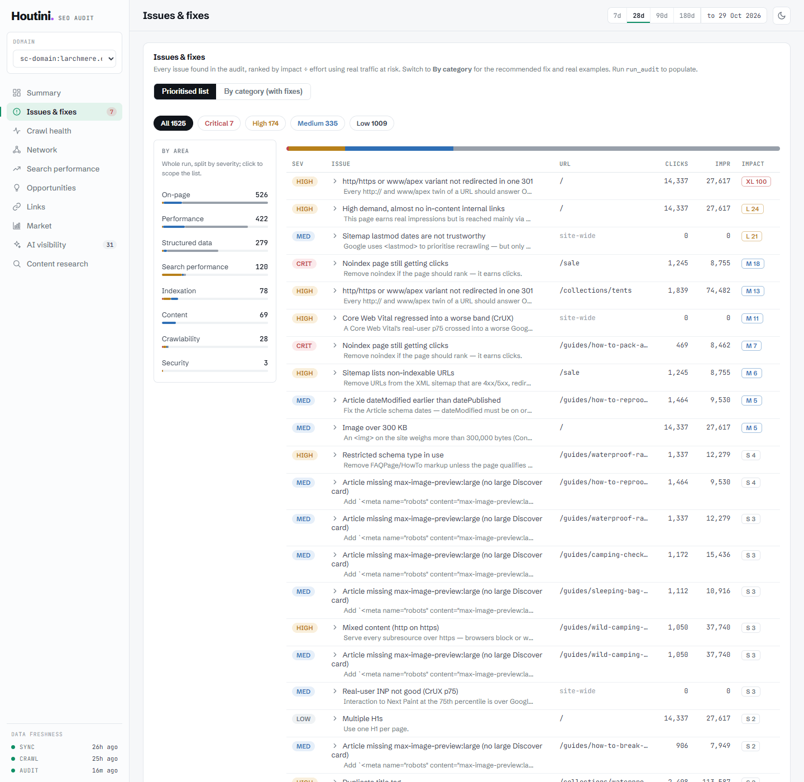
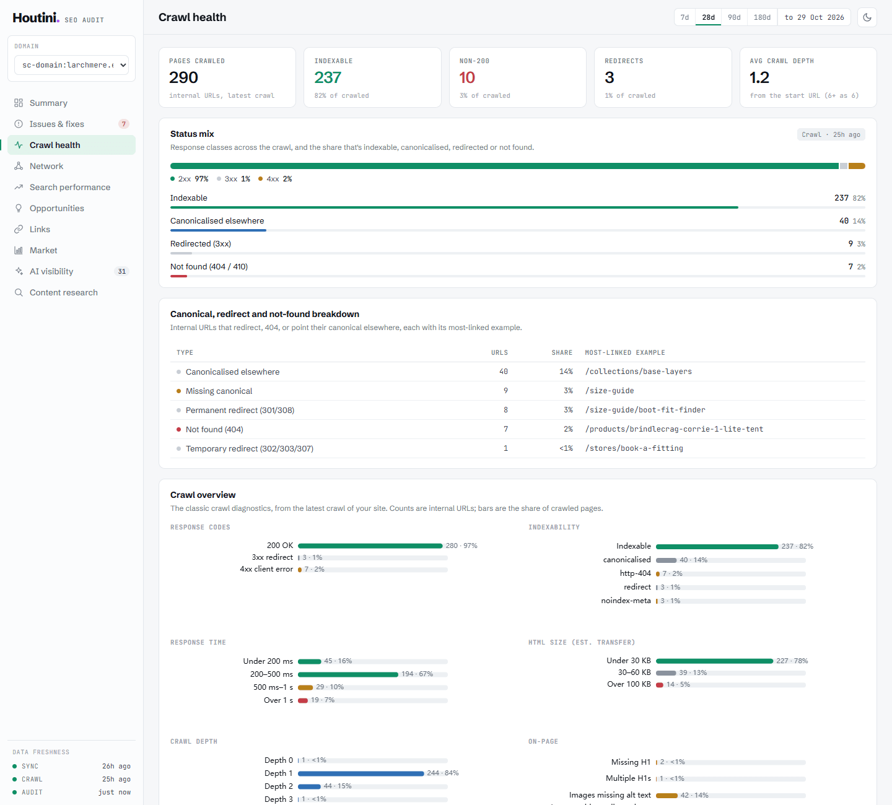
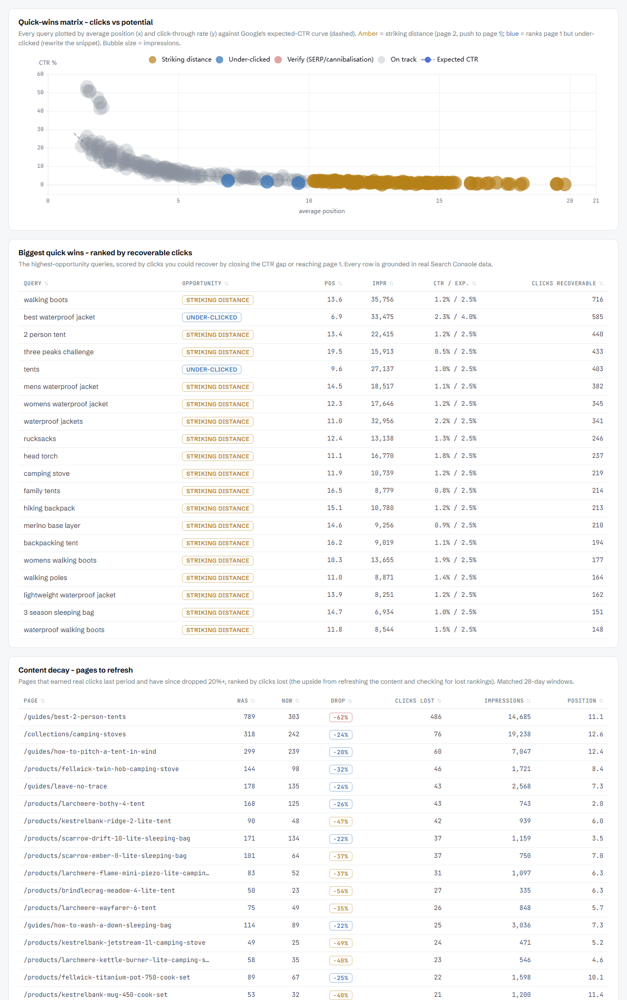
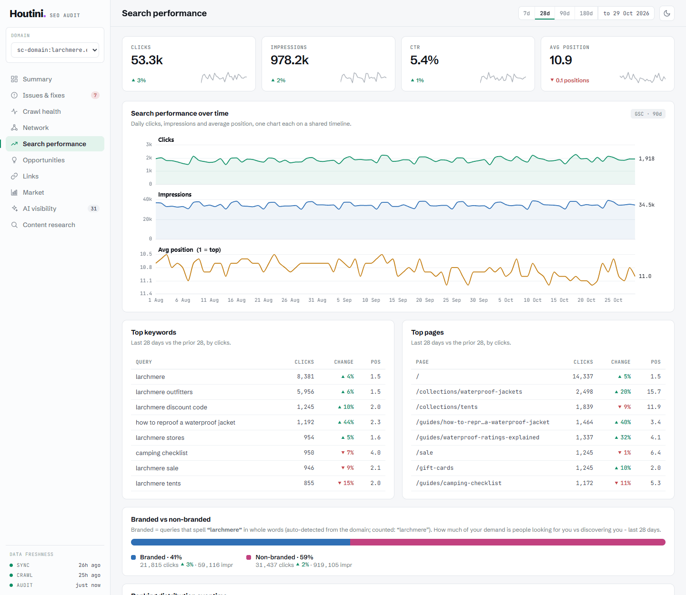
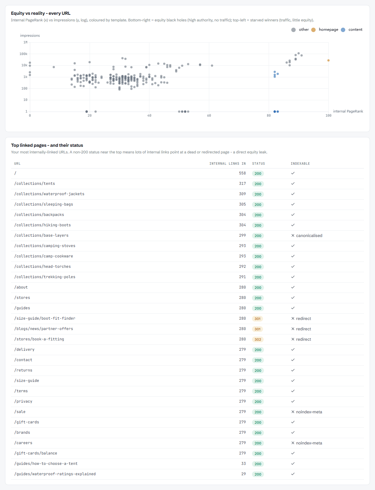
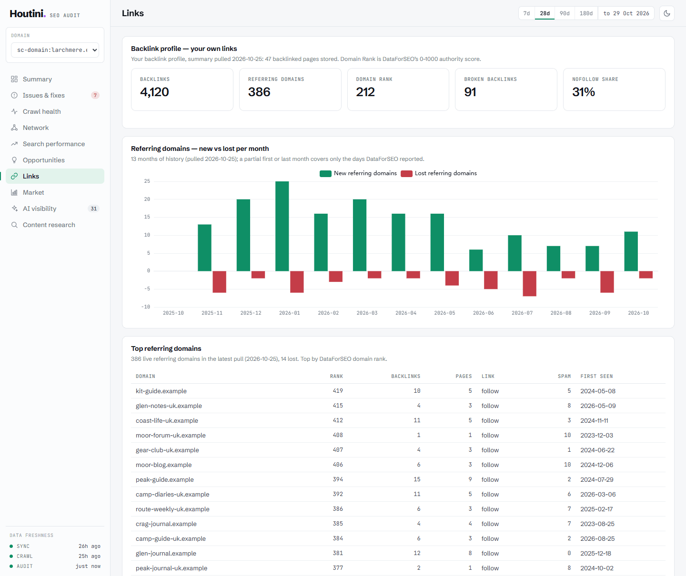
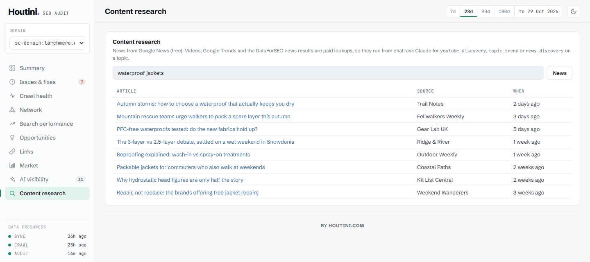

# The dashboard and reports

Three ways to look at everything at once: the interactive dashboard rendered right in the chat (*"show me the dashboard for mysite.com"*), the same dashboard in a browser tab (*"open the dashboard"*), and a single shareable HTML file (*"export the report"*). All three are built from your synced data, all are organised into ten tabs - Summary, Issues & fixes, Crawl health, Network, Search performance, Opportunities, Links, Market, AI visibility and Content research - and every number in them traces back to a datapoint in your database.

A sticky sidebar holds the Houtini mark, the domain dropdown, the tab navigation, the actions (in the browser) and a data-freshness summary, under a slim top bar. There are two themes, a graphite dark and a cool-paper light, sharing one green accent: the dashboard follows the host's theme in chat, your saved choice or system preference in the browser, and opens light in an export unless you ask for dark. The light/dark toggle in the top bar overrides any of them. Numbers are tabular and right-aligned throughout, missing values render as a dash rather than a zero, and detail lives in the tooltips rather than on the canvas.

Run `refresh_property` first, and `run_audit` if you want the findings populated. Panels that depend on an on-demand tool (search visibility over time from `track_ranks`, agent readiness from `check_agent_readiness`, market sizing, the SERP-feature footprint and so on) fill in once you've run it; everything else works from GSC and the crawl alone.

## In your browser

One dashboard covers every domain. The **domain dropdown** at the top of the sidebar lists:
- **All domains**: every domain you look after in one table, with Search Console clicks (measured) beside DataForSEO estimates, Domain Rank, AI mentions and a needs-attention tab. With more than one property, the browser opens here. Add a domain to watch with the form above the table, or remove one from its row: both are free. It's in chat too, as `get_portfolio`. Everything about it is in [portfolio.md](portfolio.md).
- **Your properties**: each opens the tabs described below. Two of them carry that domain's DataForSEO overview (monthly, refreshed from chat): **Market** (estimated traffic and keywords, positions, countries, backlinks, top pages) and **AI visibility** (see below).
- **Watched** domains: each opens its overview.
- **Backlink data only**: a database `pull_backlinks` or `link_intersect` made for a site that isn't yours. It is not counted as one of your domains.

**Actions** (browser only, free): the sidebar starts a crawl, a Search Console sync, URL inspection, an audit or an agent-readiness check for the property, and shows each job's progress with a Cancel link. One job of a kind runs per property at a time. Behind the Docker gateway the dashboard queues Search Console jobs for the job runner, which holds the credentials. Anything that costs money (DataForSEO refreshes, backlinks, rank history) still starts from chat, where it's quoted first.

**Hiding a property**: "Hide this property" at the foot of a property's actions leaves it out of the dropdown and the portfolio - for a stray URL-prefix twin of an `sc-domain:` property, say. Its data is kept; All domains lists hidden properties with a Show link. In chat: `data_storage` with `hide: {siteUrl}` (`hidden: false` to show it again).

The old `/portfolio` links redirect.

## AI visibility

One tab for how the site shows up in AI search:
- **Readiness and access** (free, from your own probes): the agent-readiness score by category, which AI crawlers robots.txt lets in (search and citation crawlers apart from training ones), and AI Overview presence on the queries content recon checked.
- **AI mentions** (DataForSEO LLM Mentions, monthly, from a portfolio refresh): mentions and AI search volume per platform - Google AI Overviews, and ChatGPT (US data only) - over 15 months, the pages cited, joined to your crawl status and Search Console clicks, the sources cited alongside, and for owned sites the rank-and-citation table from content recon.
- **Not measured**, and said so: Perplexity, Gemini, AI Mode, and any single 0 to 100 "visibility score".


> Open the dashboard for mysite.com

`open_dashboard` (or `serve_dashboard`) starts a small webserver on `127.0.0.1` and hands you a link. It reads the live database on every load, so it's always current, and it adds the domain dropdown, the actions and working CSV downloads. You rarely need to ask: a finished sync, crawl, inspection or refresh starts it and puts the link in the job's result, and `run_audit` does the same. Set `SAC_AUTOSERVE=0` to stop that automatic start. Two URL options help with sharing and screenshots (add them after `?`, or after `&` when the link already carries `?siteUrl=`): `theme=dark` or `theme=light` opens in a theme, and `redact=1` blurs the property name, the traffic figures and the URLs in the tables, and hides the network map's labels.

**Behind the Docker MCP gateway** the MCP server's container publishes no ports, so a link it serves can't be reached from your machine. For that setup there's a standalone dashboard, `seo-audit-dashboard` (`dist/dashboard.js` in the package), which you run as its own container on the same data volume and a fixed, published port:

```bash
docker run -d --name seo-audit-dashboard \
  -p 127.0.0.1:8788:8788 \
  -e SAC_DASHBOARD_BIND=0.0.0.0 -e SAC_DASHBOARD_PORT=8788 -e SAC_DATA_DIR=/data \
  -v seo-audit-data:/data \
  --entrypoint node <your-image> dist/dashboard.js
```

Then open `http://127.0.0.1:8788/`. It serves the identical dashboard from the database the MCP writes, including the job and data-freshness status. Mount the volume writable: the actions start jobs. Its Search Console jobs are queued for the job runner, which holds the credentials; a crawl, audit or agent-readiness check runs in the dashboard container itself when no runner is up. Content research in the browser runs the free Google News lookup only; the paid DataForSEO lookups run from chat. Use the volume name you gave the MCP server (see the README's [Docker section](../README.md#docker-and-the-docker-mcp-gateway)); on Git Bash for Windows, prefix the command with `MSYS_NO_PATHCONV=1` so `/data` isn't rewritten into a Windows path. Bound to `0.0.0.0` inside the container, the server still only answers requests addressed to localhost, which stops a web page reaching it, but it is not a password: publish the port to `127.0.0.1` only, as the command does.

## Summary



The landing tab, and the one to hand someone who has never seen the property. It answers, top to bottom: how fresh is this, how is the site doing, is it better or worse, what's broken, what to do first, and what we don't measure. Every number on it comes from your database; nothing is estimated or written by a model, and anything missing says so in words instead of showing a zero.

- **Freshness** - one line per source (Search Console, crawl, audit, URL inspection, ranks) with its age. A source turns amber on a stated rule, shown in its tooltip: Search Console more than 7 days behind, a crawl or audit older than 30 days, or an audit that ran before the latest crawl (so its findings describe the previous crawl).
- **The verdict** - one sentence built from a template, e.g. *"Organic clicks are down 12% on the prior 28 days (non-brand down 18%); 3 critical issues are open, 14 resolved since the last audit; 27 pages changed since the last crawl."* "Flat" means within ±5%. A clause is left out when its data is missing, so you'll never read "0 critical issues" before an audit has run, and the issues shown are always the latest audit that finished (a failed or still-running audit never replaces it). When your synced history doesn't fully cover the prior 28 days (it starts later, or a sync gap leaves under 90% of its days), there's no comparison: the verdict gives the current clicks and says so, and the tiles read "no prior" rather than comparing with zero. Year-on-year follows the same rule.
- **Six tiles** - organic clicks (28 days vs the prior 28, year-on-year once you hold 13 months, and a sparkline of complete months), non-brand share, **site health** (the share of crawled pages with no critical or high issue, counting every affected page even past the 500 findings a check stores, with its definition; the Weak / Fair / Good / Excellent bands are our convention, not an industry benchmark), indexed pages as *n of M inspected* (URL Inspection is a sample, never a share of the site), **field Core Web Vitals** from the Chrome UX Report (pass or fail per device on LCP, INP and CLS at p75, with a sparkline of phone LCP; it asks you to run `sync_crux` until there's data), and AI readiness.
- **Organic clicks by month** - up to 16 months. The current month is a hollow bar until it's complete, the dashed line is the same month last year (only where both months are complete), and each crawl and audit is ticked under the axis.
- **Health and audit change** - the health score at each audit, and the issues opened and resolved between audits. Two audits are only compared when they ran the same checks over the same scope; otherwise the reason is printed (for example, a release added checks).
- **What's broken, by area** and **Do this first** - the latest audit by category (pages with a critical, high, medium or low issue, and the change since the last comparable audit), next to the five highest-impact fixes with the pages affected, the clicks those pages earn now (not a forecast), the size of the fix and whether the evidence is deterministic (D), judgement (N) or from Search Console (G). Click either to open Issues & fixes filtered to it.
- **Changed since the last crawl** - pages now erroring, noindex added, canonicals and titles changed, pages added or no longer reached: `detect_changes`, summarised. With one crawl it says it needs two; if a newer crawl was never snapshotted, it says the comparison isn't current instead of showing old numbers.
- **Ranking mix** and **gaining and losing pages** - where your impressions sit by average position now vs the prior 28 days, and the biggest click movers among pages with at least 10 clicks in the prior 28 days.
- **AI search** - the agent-readiness score, which AI crawlers your robots.txt lets in (grouped into search and citation bots vs training crawlers: blocking GPTBot, a training crawler, doesn't take you out of ChatGPT search), AI Overview presence as *n of M checked queries* from content recon, and a plain "not measured" for answer share in chat assistants, because we don't query them.
- **Data coverage** - what's held (months of Search Console, crawled pages, URL inspection, lab Core Web Vitals, backlinks, field Core Web Vitals with its windows) and what isn't collected (server logs, and anything you haven't pulled yet). The CSV exports sit below it.

It works crawl-only: before Search Console is connected, the traffic panels ask you to connect it and everything else still works. If your Search Console history holds two row shapes for the same days (all-country and per-country rows, which a plain sum would count twice), the Summary says so; every figure in the dashboard and the audit reads one shape per day, the fuller one, so each day counts once.



The same tab in the dark theme:



## Issues & fixes



The audit findings, two ways: a **prioritised list** (the same order `run_audit` returns - expected clicks per developer-hour) and a **by-category view with fixes**, where each check groups its affected pages with the remediation attached. Severity chips and a by-area filter narrow either view. The list starts with the 50 highest-impact findings; a filter, or **Show more**, pages through every finding that matches, so a chip that counts 386 lists all 386 (an exported report, which has no server behind it, filters the top 50 and says so). Click a finding to open its **Evidence** and **Fix** side by side: **Copy fix** copies the fix text, and **Verify live URL** (in the browser) fetches the page now - status, redirects, canonical and robots - so you can see whether it's already fixed. For generated fixes (JSON-LD, redirect rules, internal links) ask Claude to run `fix_finding`.

Each finding shows an **impact score (0-100, normalised to the run's biggest finding)** and a **size badge (S / M / L / XL)** rather than a raw clicks forecast. That's deliberate: the underlying model estimates recoverable clicks, but presenting a precise number would read as a promise, and it isn't one. Real measured traffic stays real; estimates stay relative.

## Crawl health



If you grew up on desktop crawlers, this tab is home. It opens with a KPI strip (pages crawled, indexable, non-200, redirects, average crawl depth), then the **status mix** (2xx / 3xx / 4xx / 5xx across the crawl, and the share that's indexable, canonicalised, redirected or not found), then the **canonical, redirect and not-found breakdown**: the internal URLs that redirect, 404 or canonicalise elsewhere, each bucket with its most-linked example. Then the classic crawl diagnostics as clean stat bars: **response codes**, **indexability reasons** (with the *why* for every non-indexable URL), **response-time** and **HTML-size buckets** (measured on estimated transfer, not raw bytes), **crawl depth**, and title/meta issue counts. Below the bars, the lists: server errors (5xx), pages over a second, and the heaviest images your pages load - sampled from response headers during the crawl, so the image bytes are never downloaded.

It also carries the thematic reports a dedicated crawler would, each appearing when its data is present: **Security & HTTPS** (the share of pages carrying HSTS, CSP, X-Frame, X-Content-Type and Referrer-Policy), **Structured-data coverage** (the JSON-LD rich-result types across your pages), **Redirect chains** (multi-hop redirects captured during the crawl), **Core Web Vitals - lab** (after `page_lighthouse`), and **Hreflang** (declared languages, on multilingual sites).

**Core Web Vitals - real Chrome users** (after `sync_crux`, which needs a free `CRUX_API_KEY`): the Chrome UX Report's field data for your origin, phone and desktop side by side. Each device gets a pass or fail on Google's thresholds at the 75th percentile (LCP 2.5 s, INP 200 ms, CLS 0.1), each metric its p75, its band and the share of visits that were good, needed improvement or were poor, then FCP and TTFB as diagnostics and the LCP breakdown (server response, resource load delay, load duration, render delay: which part of LCP to fix). Under them, p75 per 28-day window for LCP, INP and CLS, one line per device, with Google's "good" line dashed. The windows overlap a week apart, so read the lines as a trend, never add them up. A metric with too little Chrome traffic says so instead of showing a zero, and when CrUX has no current record (only older history windows) the card says how old its newest window is. Before the first `sync_crux` the card says how to fill it.

## Opportunities



Where the growth work lives:

- **Content architecture** - your search demand grouped into topic clusters, each a pillar topic with its supporting sub-topics. Every member is coloured by how well you cover it (green = a page ranks page 1, amber = striking distance, red = a gap with no covering page), with a coverage score per cluster, a funnel read where intent data exists (run `search_intent`), and pillar-to-member internal-link suggestions. **How it works:** the clusters come from your own Search Console demand, not a third-party keyword index - we take the queries you earn impressions for, group them lexically, map each to the page that serves it and the position it holds, classify it covered (ranks ≤10) / thin (11-20, striking distance) / gap (no page ranks), and roll that up into the cluster with its coverage %. It answers "given what my site already covers, what should I strengthen or create next, and where does it fit" - grounded in real demand, inventing nothing.
- **Quick-wins matrix** - current clicks against recoverable potential, per page, so the underpriced fixes jump out.
- **Biggest quick wins** - the same thing as a ranked table.
- **Market sizing** - share of voice per topic cluster against your named competitors (after `market_sizing`).
- **SERP-feature footprint** - how much of your keyword volume carries AI Overviews, featured snippets, People Also Ask and the rest, split by whether you're on page 1 (after `serp_features`).
- **Content decay** - the refresh list: pages losing clicks period-over-period.
- **Keyword cannibalisation** - the competing URLs per query, with each URL's share of the impressions, so the consolidate-or-differentiate call is made on numbers.
- **Cannibalisation over time** - my favourite chart in the product: for a contested query, which URL Google picked, week by week. When the lines braid, Google can't decide, and that's the page pair to fix first.

## Search performance



The Search Console view you wish Google shipped - and because the history lives in your own database, it isn't capped at 16 months.

**The window** (browser only): the control in the top bar sets the comparison window - the last 7, 28, 90 or 180 days against the same length before - for the tiles, the keyword and page tables, the branded split, the breakdowns and content decay, on every tab except the Summary. The Summary keeps its fixed 28 days, and says so in the top bar. The window is in the URL (`?days=90`), so a link opens on it. 28 days is cached; another window is built when you pick it.


- **Search performance over time** - daily clicks, impressions and average position as three small charts on one timeline.
- **Top keywords and top pages** - the window against the one before, by clicks.
- **Branded vs non-branded** clicks split. The brand is your domain name without its ending; a query counts as branded when its whole words spell it, spaced or not (for simracingcockpit.gg: "simracingcockpit", "sim racing cockpit", "simracingcockpit.gg", but not "sim racing cockpits"). The spellings it matched are listed above the bar. On a descriptive domain the spaced name is also the generic search, so read the split with that in mind.
- **Ranking distribution over time** - impressions by position bucket, the honest "are we improving" chart.
- **Search visibility over time** - the DataForSEO monthly rank distribution, with the keyword count and estimated traffic volume as separate small charts rather than a dual axis, reconciled with your GSC dates (needs `track_ranks`).
- **Rank & clicks over time** - average position and clicks as two small charts on one shared timeline.
- **Top keyword and page performance**, the window against the one before.
- **Keyword ranking movement** over 90 days - risers and fallers.
- **Breakdowns by device and country** - these appear when you've synced with `segments:true` ([tools.md](tools.md#sync_gsc)).
- **GSC index coverage** - Google's own per-URL index status from URL Inspection (run `inspect_urls`): the coverage-state distribution and any Google-vs-declared canonical conflicts.

Tables export to CSV where you'd want them to.

## Network



The structural story - where your internal link equity goes versus where your traffic comes from:

- **Site network** - a force-directed graph of your internal link skeleton: the top pages by internal PageRank and the in-content links between them. Node size is internal PageRank; colour is health (green indexable, amber non-indexable, red broken or redirected), so a cluster of amber or red high up is a structural problem you can see at a glance. Drag to explore, scroll to zoom, click a node to open the page.
- **Equity flow vs traffic by template** - each template's share of internal PageRank against its share of impressions. A template hoarding equity while earning nothing is a structural decision worth revisiting.
- **Where link equity flows, folder to folder** - a Sankey of internal PageRank moving between site sections, so you can see which sections feed which.
- **Equity vs reality, every URL** - the scatter of internal PageRank against impressions. The corners are the findings: high equity + no traffic (wasted authority), high traffic + no equity (underlinked winners, and the pages a redesign would quietly kill).
- **Top linked pages and their status** - your most internally linked URLs with their live HTTP status. A non-200 high on this list is an equity leak in plain sight.
- **Trapped authority** - pages the web trusts (referring domains from `pull_backlinks`, plus Majestic **Trust Flow** and its top topic when `MAJESTIC_API_KEY` is set during the pull) that sit buried deep in your architecture - click depth 3+ from the homepage, or unreachable through the body - so their link equity never reaches your money pages. The fix: link to them from higher up.
- **Agent readiness** - the 0-100 score and category checklist from `check_agent_readiness`, once you've run it.
- **AI answerability** - a local cross-encoder scores whether each ranking page carries a dense, extractable answer for its top query (run `score_passages`). Weakest first; a score under 3 means there's no clear passage an AI can lift. No other tool checks this.
- **Entity & topic graph** - your pages resolved to Wikidata entities (run `resolve_entities`) and the subclass / part-of edges between them - a map of the concepts your site covers.

## Links



**Backlink profile** (top of the tab): your own links, from `pull_backlinks`. A KPI strip (backlinks, referring domains, DataForSEO Domain Rank, broken backlinks, nofollow share), a new-vs-lost referring-domains chart per month from DataForSEO's monthly history, the top referring domains by rank, the anchor mix (branded, keyword, URL, generic, empty, by share of backlinks), your most-linked pages with the live HTTP status the pull resolved, and the backlinked pages that answer 4xx/5xx. Every number is a stored row; a section whose table was never filled says **not collected** rather than showing zero, and a pull made before 0.16 shows the summary and pages only until you re-run it.

Link intersect: the domains linking to your competitors but not to you - a ready-made outreach list. Run `link_intersect` for a property (a DataForSEO Backlinks call) and this fills with the prospects, sorted followed-first then by domain trust. With a **Majestic** key set, each prospect is re-sorted by **Trust Flow** and shows its top topic, so directory noise sinks and genuinely on-topic authority rises. No DataForSEO key? The tab shows a one-click prompt to connect one.

## Content research



On-demand topic research: type a keyword and pull recent **News** (free Google News plus DataForSEO), the ranking **Videos** (YouTube SERP), or the **Trend** direction (Google Trends - rising, falling or flat). The "what's being published and who's covering it" panel - each button is a live lookup, and the DataForSEO calls are cached for 20 days. **In chat** (`get_dashboard`) all three run, and need DataForSEO credentials (without them the tab shows a prompt to connect an account); clicking a keyword there also looks up its related searches and volume, a paid call. **In the browser dashboard** only the free Google News lookup runs: anything that spends DataForSEO money starts from chat, where it's quoted first, so a web page can never spend your credit. Research never runs in an export.

## Exporting: `export_report`

> Export the report for mysite.com

Writes the whole dashboard - data and charts inlined - to a single self-contained HTML file in your reports folder (under the data directory, path returned by the tool). Open it in any browser, attach it to an email, hand it to a client; the recipient needs nothing installed and nothing running. It's a snapshot of the moment you exported, so re-export after a refresh when you want current numbers. A `theme` option gives you light or dark.

One honest limitation: the in-chat widget and the export are the same dashboard, so anything the widget can't show (because you haven't synced or run the relevant tool), the export can't either. The export tells you the finding count it shipped with, which is a decent staleness check.
