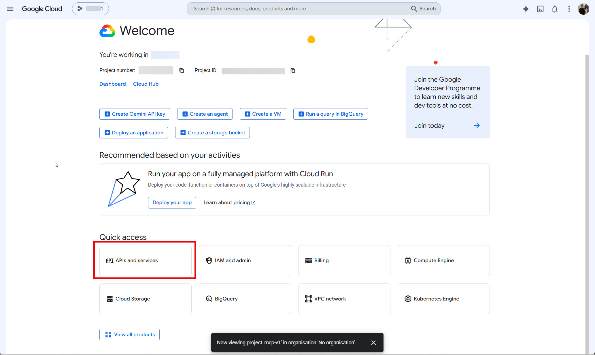
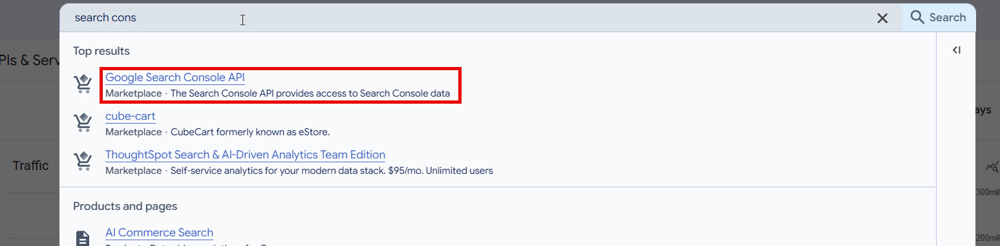
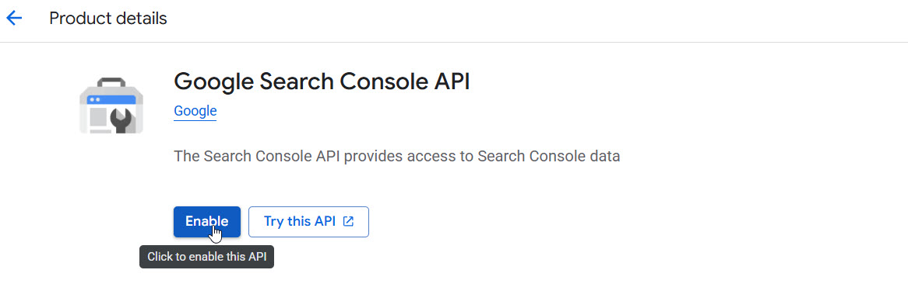
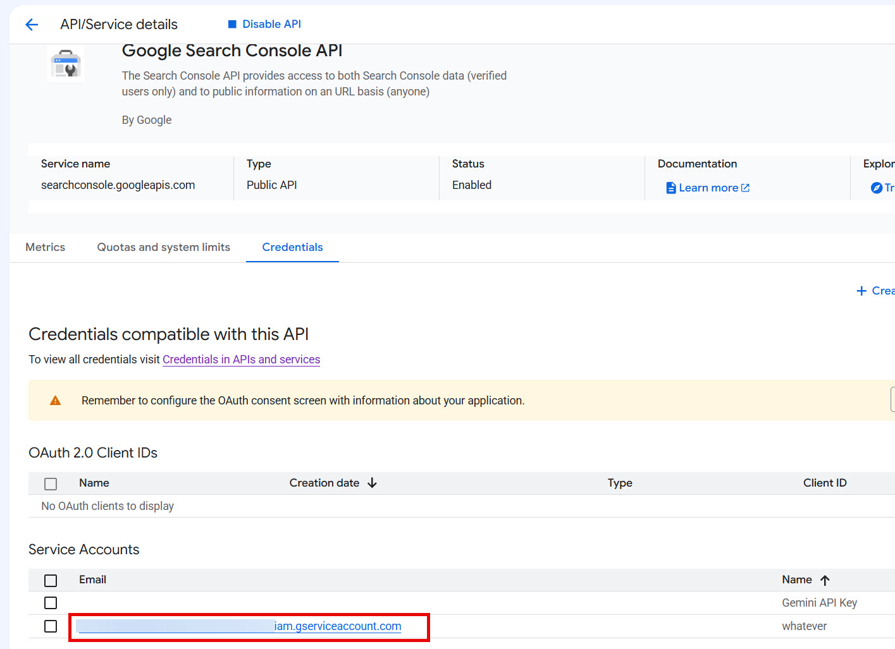
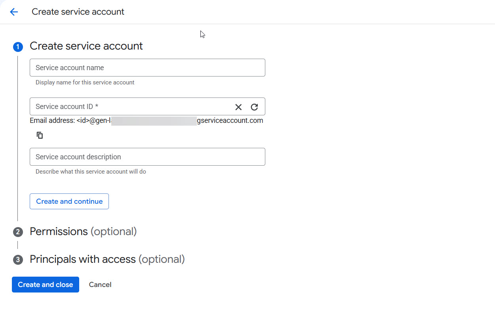
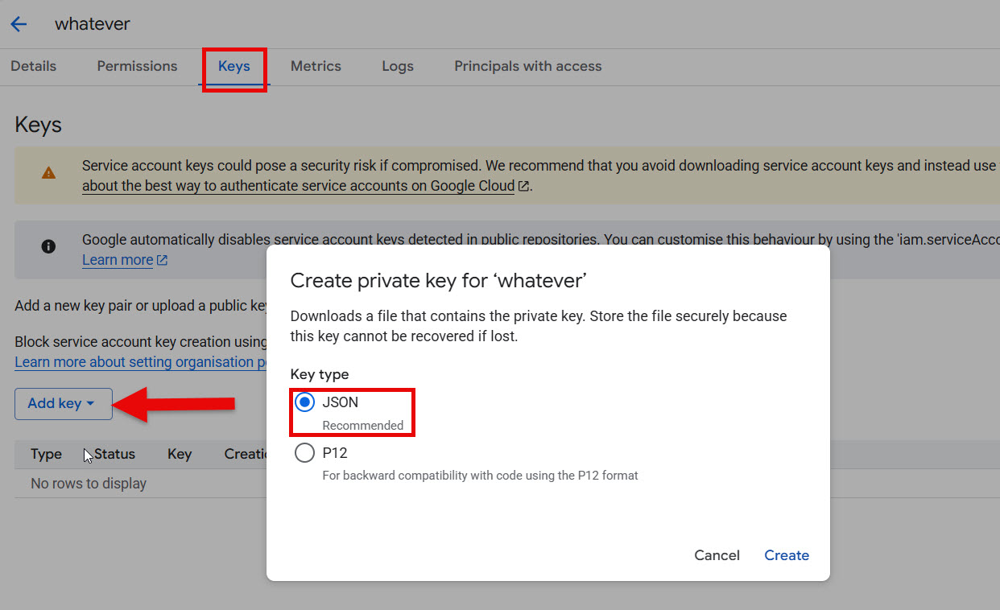
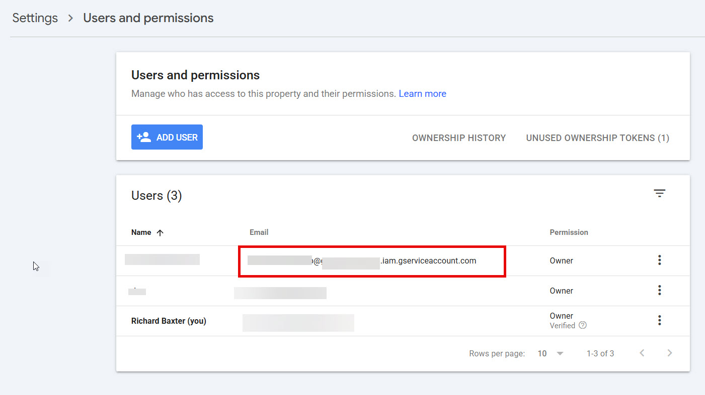

# Getting started

This page takes you from nothing to your first audit: install, connect Google Search Console, wire it into Claude Desktop or Claude Code, run the first refresh, and read the results. It's a one-time, ten-minute setup job, and the step people miss is flagged clearly below.

## What you need

- **Node.js 22 or newer** (Node 20 reached end-of-life in 2026; never installed it? Step 0 below walks you through it)
- **Git** - or not; you can skip it entirely with the ZIP download in step 1
- **Claude Desktop** or **Claude Code** (any MCP client works; these are the two I test on)
- A **Google Search Console property you own**. If your site isn't verified there yet, do that first - it's free, takes ten minutes, and you should have it regardless of this tool.
- *Optional:* a **DataForSEO** account, for keyword volumes, competitor data and backlinks. Everything else works without it. See [competitive.md](competitive.md) for what it adds and what it costs.
- *Optional:* a free **Chrome UX Report (CrUX) API key**, for real-user Core Web Vitals - including INP, which no lab tool can measure. Setup takes five minutes in Google Cloud: [CrUX key (optional)](#crux-key-optional) below.
- *Optional, and only if you do link building:* a **[Majestic](https://majestic.com/plans-pricing)** API key. It enriches the `link_intersect` prospect list with **Trust Flow** and **Topical Trust Flow** and re-sorts it by real editorial authority, which is what stops directories sitting at the top of your outreach list. `link_intersect` runs fine without it.

## The quick route: npx (no clone, no build)

The tool is on npm, so you can skip Git and the build entirely - you still need Node.js from step 0, but nothing else. Point your MCP config straight at the package:

```json
{
  "mcpServers": {
    "seo-audit-console": {
      "command": "npx",
      "args": ["-y", "@houtini/seo-audit-console"],
      "env": {
        "GOOGLE_APPLICATION_CREDENTIALS": "C:/path/to/service-account.json"
      }
    }
  }
}
```

That's the minimum config - one env var. Every optional service (DataForSEO, Majestic) is another line in the same `env` block; the full list is [in step 3](#environment-variables) below.

npx downloads and runs the published build on first launch, and you pick up new versions without ever touching a terminal again. The clone-and-build route below is for anyone who wants the source - to read it, extend it, or run ahead of releases. Everything from step 2 (Search Console) onwards is identical for both routes.

## One-click install (Claude Desktop extension)

There's also a packaged Claude Desktop extension - a `.mcpb` bundle you double-click (or drag into Claude Desktop's Settings → Extensions) and it installs itself, dependencies included (Claude Desktop supplies the Node runtime). Claude Desktop then prompts you for the settings instead of you editing JSON: a file picker for the Google service-account key, an optional data directory, and then the optional keys - DataForSEO and Majestic (the Trust Flow tier for `link_intersect`) - each safe to leave blank, because a blank one simply leaves its tier switched off.

Honest status: the bundle on our [GitHub releases](https://github.com/houtini-ai/seo-audit/releases) page **lags the npm package** - the newest one there is v0.5.1, many releases behind - and it's still pending review for the Claude extension directory. Until a current bundle is published, **use the npx route above**: it always runs the latest release. If you do try a bundle, you still need the Search Console service account from step 2 below (the extension only removes the JSON-editing steps), and note it's built per platform (native SQLite/ONNX modules) - the bundle is built for Windows.

## 0. Install the tools this tool is built with

If you're an SEO rather than a developer, your machine probably doesn't have Node.js or Git yet. Both are free, both install in a couple of minutes, and neither will bother you again afterwards.

**Node.js** is the runtime the server runs on - it's what Claude actually starts when it loads the tool.

- **Windows:** download the **LTS** installer from [nodejs.org](https://nodejs.org), run it, accept the defaults. Done.
- **Mac:** same [nodejs.org](https://nodejs.org) LTS installer works; if you already use Homebrew, `brew install node` does the same job.

Check it worked - open a terminal (Windows: search for "PowerShell"; Mac: search for "Terminal") and type:

```bash
node --version
```

Anything starting `v22` or higher and you're set. `npm` (the package installer used below) comes bundled with it - nothing extra to do.

**Git** is how you download the code and, later, pull updates with one command.

- **Windows:** download from [git-scm.com](https://git-scm.com/download/win), run the installer, accept the defaults (there are a lot of option screens; the defaults are all fine).
- **Mac:** type `git --version` in Terminal - macOS offers to install its command-line tools if Git isn't there yet. Say yes.

**Don't fancy Git at all?** You don't strictly need it. On the [GitHub page](https://github.com/houtini-ai/seo-audit), click the green **Code** button, then **Download ZIP**, and unzip it somewhere sensible (not your Downloads folder - you'll be pointing Claude at this location permanently). The trade-off: updating later means downloading a fresh ZIP rather than typing `git pull`.

## 1. Build it

In your terminal, in the folder where you want the tool to live:

```bash
git clone https://github.com/houtini-ai/seo-audit.git
cd seo-audit
npm install
npm run build
```

(If you took the ZIP route, skip the first line - just `cd` into the unzipped folder and run the last two.)

The build produces `dist/index.js` - that's the file your MCP config points at. If `npm install` throws certificate or proxy errors on a corporate machine, that's your IT department's network filtering, not the tool - your IT team will recognise the fix immediately.

To update to a newer version later:

```bash
git pull
npm install
npm run build
```

then fully restart Claude (Desktop holds the old build until you do - see the restart note in step 3a).

## 2. Connect Google Search Console

The tool reads GSC through a **Google Cloud service account** - a robot login you create once, instead of an OAuth dance every session. If you'd rather follow a version with screenshots, the [Setting it up from scratch](https://houtini.com/articles/better-search-console/#setting-it-up-from-scratch) guide on houtini.com walks the identical flow, including the permissions screen from step 3 below.

1. In [Google Cloud Console](https://console.cloud.google.com), create a project and **enable the Search Console API**. From the console home, open the APIs section:

   

   Search the API library for "search console":

   

   And enable it:

   

2. Create a **service account**. Once the API is enabled, its page offers the route straight there - follow the highlighted service-account link (or IAM & Admin → Service Accounts):

   

   Then create the account - the name doesn't matter, something like `seo-audit` is fine:

   

   Once it exists, open it, go to the **Keys** tab → **Add key** → **Create new key** → **JSON**, and a key file downloads:

   

   Keep that file somewhere sensible; you'll reference its path in the config.
3. In [Search Console](https://search.google.com/search-console), under *Settings → Users and permissions*, add the service account's **email address** as a user on each property you want to audit (copy the email from the service-accounts list - it ends `.iam.gserviceaccount.com`).

   This is what done looks like - the service account sitting in the users list:

   

   (Full user is enough for everything this tool does; Owner also works, as shown.)

**Step 3 is the one everyone misses.** The service account is its own "person" with its own email address (it looks like `something@your-project.iam.gserviceaccount.com`). Until you add that email to the property, it sees nothing - exactly as a new colleague would. If `list_properties` comes back empty later, this step is almost always why.

## 3a. Configure Claude Desktop

Add this to `claude_desktop_config.json` (Settings → Developer → Edit Config):

```json
{
  "mcpServers": {
    "seo-audit-console": {
      "command": "node",
      "args": ["C:/path/to/seo-audit/dist/index.js"],
      "env": {
        "GOOGLE_APPLICATION_CREDENTIALS": "C:/path/to/service-account.json",
        "SAC_DATA_DIR": "",
        "DATAFORSEO_USERNAME": "",
        "DATAFORSEO_PASSWORD": "",
        "DATAFORSEO_CACHE_DAYS": "20",
        "MAJESTIC_API_KEY": "",
        "MAJESTIC_CACHE_DAYS": "30",
        "CRUX_API_KEY": ""
      }
    }
  }
}
```

That's the everything block - every variable most people will ever set, so you can see the shape (the rarely needed ones are listed under [Environment variables](#environment-variables)). `CRUX_API_KEY` is optional: field Core Web Vitals, from a free Google API key restricted to the Chrome UX Report API ([setup below](#crux-key-optional)); an empty string leaves it off. Delete the lines for services you don't have, or leave their values blank to disable them; only `GOOGLE_APPLICATION_CREDENTIALS` is required, and each optional key just switches its own tier on (`MAJESTIC_API_KEY`, for instance, only ever does anything when you run `link_intersect` or `pull_backlinks`). Then **fully restart Claude Desktop** - quit it from the system tray, not just the window. Claude Desktop keeps the old server process running until you do, which catches people out constantly.

## 3b. Configure Claude Code

Claude Code is, in my view, the best home for this tool - the audit finds the issue, and the same session has your site's repo, a terminal and git to apply the fix. Two ways to register it:

**One command:**

```bash
claude mcp add seo-audit-console \
  --env GOOGLE_APPLICATION_CREDENTIALS=C:/path/to/service-account.json \
  --env DATAFORSEO_USERNAME=you@example.com \
  --env DATAFORSEO_PASSWORD=your-dataforseo-password \
  --env MAJESTIC_API_KEY=your-majestic-api-key \
  -- npx -y @houtini/seo-audit-console
```

(Drop any `--env` line you don't need - the first one is the only one that's required. Built from source? End the command with `-- node C:/path/to/seo-audit-console/dist/index.js` instead.)

**Or a project-level `.mcp.json`** (checked into your site's repo, so the whole team gets it). npx is the right fit here - teammates run the published package without needing a local clone of this repo:

```json
{
  "mcpServers": {
    "seo-audit-console": {
      "command": "npx",
      "args": ["-y", "@houtini/seo-audit-console"],
      "env": {
        "GOOGLE_APPLICATION_CREDENTIALS": "C:/path/to/service-account.json"
      }
    }
  }
}
```

Don't commit real credential paths to a shared repo unless the team shares the service account. The JSON key file itself must never be committed anywhere.

### Environment variables

| Env var | Required | Purpose |
|---|---|---|
| `GOOGLE_APPLICATION_CREDENTIALS` | yes | Path to the GSC service-account JSON key |
| `SAC_DATA_DIR` | optional | Where per-property SQLite databases and reports live (default: `~/Documents/seo-audit-console`) |
| `DATAFORSEO_USERNAME` / `DATAFORSEO_PASSWORD` | optional | Switches on the keyword / SERP / competitor / CWV / backlink tools |
| `DATAFORSEO_CACHE_DAYS` | optional | DataForSEO response cache TTL (default 20 days) |
| `MAJESTIC_API_KEY` | optional | Switches on the **Majestic** tier in `link_intersect`: every prospect gains **Trust Flow** and **Topical Trust Flow**, and the list re-sorts by real editorial authority instead of DataForSEO's link-volume rank. `pull_backlinks` also adds Trust Flow to your own most-backlinked pages (up to 500), for the dashboard's Trapped authority report. Get a key on [Majestic's plans page](https://majestic.com/plans-pricing). Both tools work without it. |
| `MAJESTIC_CACHE_DAYS` | optional | Majestic response cache TTL (default 30 days). Cache hits cost no Majestic units, so leave this generous. |
| `CRUX_API_KEY` | optional | Switches on `sync_crux` and the CrUX step of `refresh_property`: real-user Core Web Vitals from the Chrome UX Report, and the `crux-field-*` / `crux-regression` checks. Free; see [CrUX key (optional)](#crux-key-optional). |

A few more exist for people who need them, and you almost certainly don't:

| Env var | Required | Purpose |
|---|---|---|
| `SAC_RERANK_DEVICE` | optional | Pins the local passage-scoring model to a device: `dml` (any DirectX 12 GPU on Windows) or `cpu`. Unset, it tries the GPU and falls back to CPU on its own - set it only if that fallback misbehaves. |
| `MAJESTIC_API_HOST` | optional | Points the Majestic client at a different host. The default is the live API (`api.majestic.com`); Majestic's developer sandbox is a frozen 2015 subset, useful for testing the wiring without spending units. |
| `SAC_AUTOSERVE` | optional | Set to `0` (or `false` / `no` / `off`) to stop the local dashboard server starting by itself after a refresh, sync, crawl, inspection or audit. `open_dashboard` and `serve_dashboard` still start it when you ask. |
| `SAC_DASHBOARD_BIND` | optional | The address the dashboard server binds (default `127.0.0.1`). Set `0.0.0.0` inside a container so a published port reaches it; it still answers only requests addressed to localhost. |
| `SAC_DASHBOARD_PORT` | optional | A fixed port for the dashboard server (default: a random free port). Needed when a container publishes the port. |
| `SAC_DASHBOARD_URL_HOST` | optional | The host written into the dashboard links the tools hand you (default `127.0.0.1`). |

Each optional key only affects its own tier, and none of those services is called until you ask a question that needs it. **Leave a key blank to disable its tier.** A value that's still a placeholder - `your-majestic-api-key`, `<your key>`, `changeme`, `xxx`, anything containing `example`, or an unsubstituted `${...}` from your MCP host - counts as blank too: the tier stays off and the server writes one line to its log, e.g. `MAJESTIC_API_KEY looks like a placeholder; Majestic tier disabled.` So if a tier you expected is off, check the log for that line.

### CrUX key (optional)

The Chrome UX Report is Google's own record of how real Chrome users experience your pages - the same field data behind the Core Web Vitals report in Search Console. It's the only way to get **INP**, and it's free. You need a Google Cloud API key with one API switched on:

1. Open the [Google Cloud console](https://console.cloud.google.com/) and pick a project. The one that holds your Search Console service account is fine.
2. Go to **APIs & Services → Library**, search for **Chrome UX Report API**, and click **Enable**.

   

3. Once it's enabled you land on the API's details page, with its status reading **Enabled**. Open its **Credentials** tab.

   

4. Click **Create credentials → API key**.

   

5. Restrict the key: under **API restrictions**, choose **Restrict key**, filter for *chrome*, tick only **Chrome UX Report API**, and click **OK**, then **Save**. A key that can call nothing else is a key you don't have to worry about.

   

6. Copy the key and add it to your config's `env` block as `CRUX_API_KEY` and fully restart the client.

Then ask *"pull CrUX data for yoursite.com"* (or just refresh the property - it runs on its own once the key is set). The API allows 150 calls a minute and the tool stays under that; the first pull for a site is about 200 calls (history, then the latest window, for the origin and 50 pages on phone and desktop), so it takes a minute or two. Pages without enough Chrome traffic simply have no CrUX data - they're recorded as *insufficient data*, never as a zero.

You can also move the data directory later without touching config - ask *"where is my audit data stored?"* or *"set the data location to D:/seo-data"* (the `data_location` tool persists the choice in `~/.seo-audit-console.json`, and it applies after you restart the client). `SAC_DATA_DIR`, if it's set, always wins over that saved choice.

## 4. First run

In a new chat:

> list properties

You should see your Search Console properties. If yours is in the list, you're connected. Then:

> Refresh sc-domain:yoursite.com

This runs up to four things in order: syncs your Search Console history, crawls your site (politely - it respects robots.txt and never downloads image bytes) and computes the internal link graph, checks how Google has indexed your top pages, and - only if DataForSEO is configured - pulls your rank history (a small paid call; `ranks:false` skips it). The first sync pulls the last 90 days (ask for an earlier start date to go deeper) so it's the slow one; every refresh after that fetches only the new days, usually seconds. On a large site the crawl is the slow part - it runs as a background job, so you don't have to watch it. Ask *"check the crawl status"* if you're curious.

When the refresh finishes, its status reply gives you a link to the updated dashboard in your browser (*"open the dashboard"* gets it any time - see [dashboard.md](dashboard.md)). Jobs are recorded in `_jobs.db` in the data directory, so a finished job's result survives a restart; one whose server process exited part-way reads as `interrupted`. Running the server in Docker or behind the Docker MCP gateway? Read the README's [Docker section](../README.md#docker-and-the-docker-mcp-gateway) first - the gateway's default per-call containers would kill a background job.

Once it's done:

> Run an SEO audit on yoursite.com

What comes back is a ranked list of findings, sorted by **expected clicks per developer-hour** - how many clicks a fix is likely to win, divided by how long it takes. Work straight down the list. Each finding carries the traffic at stake and its evidence, and for the top items you can ask:

> Generate the fix for #1

You'll get a paste-ready artefact - a redirect rule, a JSON-LD block, a ranked list of internal-link donors. The tool never touches your site; it only hands you the fix.

Want the softer, heuristic findings too (intent mismatches, weak answer passages)? Ask for them explicitly:

> Run an SEO audit on yoursite.com and include the judgement findings

They're off by default because a wrong finding is worse than no finding. See [checks.md](checks.md) for the D/N distinction.

## A suggested routine

Refresh weekly, run *"detect changes"* right after (it diffs your two most recent crawls and flags regressions), run the full audit monthly, and re-run it after any fix ships to watch the finding drop off the list. That last part is oddly satisfying.

## Running under the Docker MCP gateway

Skip this unless you run the server through the Docker MCP gateway. With npx or Claude Desktop the server is one long-lived process, and it runs its own background jobs.

The gateway causes two problems, and each has its own fix.

- **Slow start.** The gateway runs the server in a worker container: a new one for every tool call, or one per client connection with `longLived: true` on the catalog entry. Started with `npx` on `node:22-slim`, each new worker installs the package first, which takes 60-90 seconds. Claude Code gives up at about 60, so every call times out. **Fix: an image with the package preinstalled, plus `longLived: true`.** First call about 2 seconds, later calls instant.
- **Jobs dying.** The gateway replaces workers whenever it likes (a disconnect, a router recreate, an idle reap), and a crawl running inside a worker dies with it. **Fix: the job runner**, one long-running container, `seo-audit-runner`, from the same package. The server only queues each job in `_jobs.db` in the data directory, and the runner picks it up from there.

**1. Build the image** from this Dockerfile (pin the release):

```dockerfile
FROM node:22-slim
RUN npm install -g @houtini/seo-audit-console@0.17.0
ENTRYPOINT ["seo-audit-console"]
```

`docker build -t seo-audit-console:0.17.0 .`, then in the server's catalog entry set `image: seo-audit-console:0.17.0`, delete the `command:` line, and add `longLived: true`.

**2. Start the runner** once, from the same image, on the same data volume and credentials the gateway uses:

```bash
docker run -d --init --name seo-audit-runner --restart unless-stopped \
  -v mcp-sac-data:/data -v mcp-sac-creds:/creds:ro \
  -e SAC_DATA_DIR=/data -e GOOGLE_APPLICATION_CREDENTIALS=/creds/gsc.json \
  -e DATAFORSEO_USERNAME -e DATAFORSEO_PASSWORD -e MAJESTIC_API_KEY -e CRUX_API_KEY \
  --entrypoint seo-audit-runner seo-audit-console:0.17.0
```

- The `-e NAME` flags with no value copy those keys from your shell; drop any you don't use. The runner needs the same keys as the server, because it is the one that calls the APIs.
- Windows, Git Bash: put `MSYS_NO_PATHCONV=1` in front, or MSYS turns `/data` and `/creds` into Windows paths. PowerShell doesn't need it.
- `docker logs seo-audit-runner` shows the runner start and every job it claims.

**3. Add `SAC_JOB_RUNNER=external`** to the env of the server's gateway catalog entry. Keep `longLived: true`: the runner keeps jobs alive, `longLived` keeps the worker warm, and they work together.

A job now reads `queued: waiting for the job runner` until the runner claims it. If it stays queued for over a minute with no runner checking in, the status tells you no runner seems to be running, with the command above. After about two minutes without a runner heartbeat it reads `queued (no runner)`, and it no longer blocks `data_storage` prune or repair. The runner does one job at a time; `SAC_RUNNER_CONCURRENCY=2` (or more) on the runner lets jobs for different properties run side by side. To update, build the image for the new release, change the tag in the catalog entry, restart the gateway, then remove the runner container and run the command again with the new tag. A job that was running at that moment reads `interrupted`, so start it again.

If the catalog entry still runs `npx`, the server logs a warning at start-up (in `docker logs` for the gateway) pointing at this section.

**After upgrading, restart the MCP client.** Clients read the tool list once, when they connect, and keep it. Until Claude Desktop or Claude Code is restarted (fully, from the tray on Windows), tools added in the new release, such as `sync_crux`, stay invisible even though the server has them.

## Troubleshooting

- **`list_properties` is empty or errors.** Either the client isn't connected to the server yet, `GOOGLE_APPLICATION_CREDENTIALS` isn't set (the error says so), or the service account hasn't been added to your property (step 2.3 above - the classic). Fix the config, then fully restart Claude Desktop from the tray.
- **The audit comes back with 0 findings, or the dashboard says there's no synced data.** Run the refresh first and let it finish. The audit reads the local database; it doesn't fetch anything itself.
- **A large site feels slow.** That's the crawl, and it's normal. It backs off when your server rate-limits, so it stays gentle. Carry on when the progress panel says it's done.
- **A keyword or competitor tool says it needs credentials.** Those are the optional DataForSEO tools. Everything in the core flow works without them.
- **`link_intersect` shows a "Domain trust" column, not "Trust Flow".** That's the tool telling you no prospect was enriched by Majestic - usually because `MAJESTIC_API_KEY` isn't in your config's `env` block, or the client hasn't been restarted since you added it. The footer under the table suggests setting the key either way, so if it is set, look for a Majestic error instead (next item).
- **Majestic errors instead of enriching.** The message comes straight from Majestic and names the cause - a bad key, or an allowance with nothing left in it. Enrichment costs roughly one unit per prospect (batched 100 per call, capped by `enrichLimit`), so a big `topN` on a small plan runs the balance down; results are cached for `MAJESTIC_CACHE_DAYS` (30 by default), so re-running the same intersect inside that window costs nothing.
- **`pull_backlinks` errors even though DataForSEO works.** Backlinks is a separate DataForSEO subscription from SERP/Keywords/Labs - a 40204 error means it isn't activated on your account. The tool says so plainly when that's the cause.
- **You changed the code and nothing changed.** The running MCP server holds the previous build. `npm run build`, then fully restart the client.
- **A tool from the new release is missing after an upgrade** (`sync_crux`, say). The client cached the tool list when it connected. Fully restart Claude Desktop or Claude Code so it fetches the new list.
- **Under the Docker MCP gateway, the first call times out or several workers appear.** A fresh worker spends about a minute in `npx` installing the package. Pin the version and pre-warm the npm cache, or use a preinstalled image: [Running under the Docker MCP gateway](#running-under-the-docker-mcp-gateway).

Forget what's possible at any point? Ask *"run seo_audit_help"* - it returns the full menu with an example prompt for every feature.

## Where your data lives

One SQLite database per property, under `SAC_DATA_DIR` (default `~/Documents/seo-audit-console`), alongside a small cache database per external service (`dataforseo-cache.db`, `majestic-cache.db`, `wikidata-cache.db`) - that's what stops the same question being paid for twice - the job registry (`_jobs.db`) and a `reports` folder for exports. `data_storage` shows you the lot with sizes.

Your Search Console history and crawl stay on your machine; the passage-scoring model runs locally too. Nothing leaves except the API calls you trigger yourself - Google (your own GSC) and, if configured, DataForSEO and Majestic (`link_intersect` sends prospect domain names; `pull_backlinks` sends your backlinked page URLs). Content recon's competitor fetch requests those public pages directly, with no service in between. After each crawl the tool also checks the outbound links on your pages (one request to each linked URL; `checkExternal:false` skips it), and the free extras fetch from public sources: the local models download once from Hugging Face, `resolve_entities` queries Wikidata and `news_discovery` reads the Google News feed. No telemetry.

Next: [tools.md](tools.md) for the full tool reference, or [composition.md](composition.md) for asking your own bespoke questions across the data.
